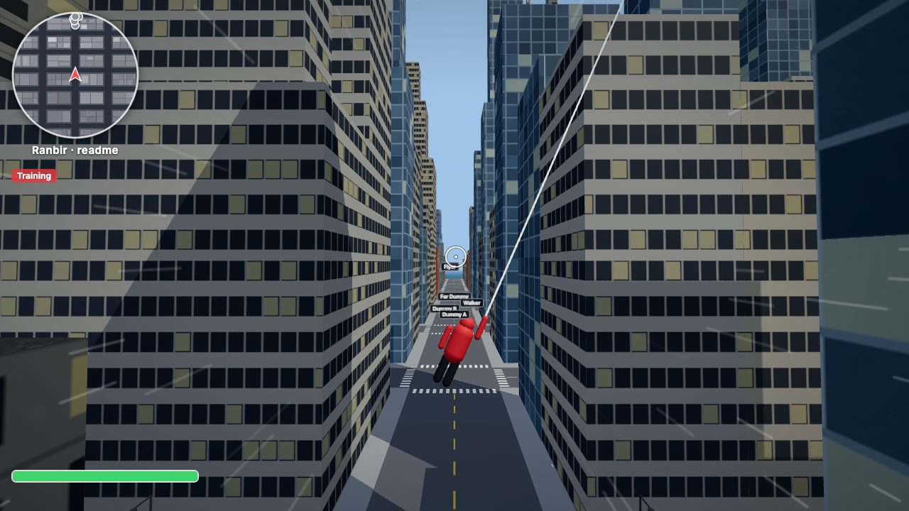
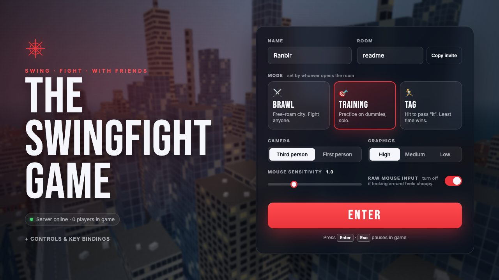
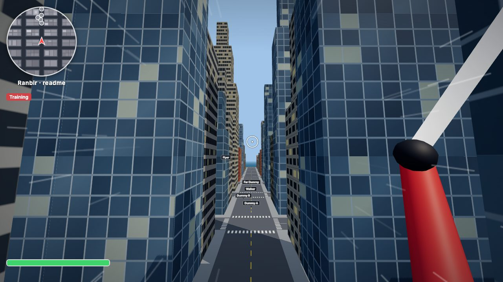
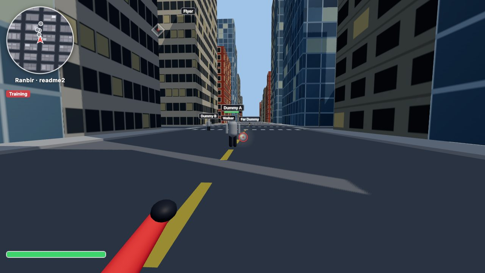
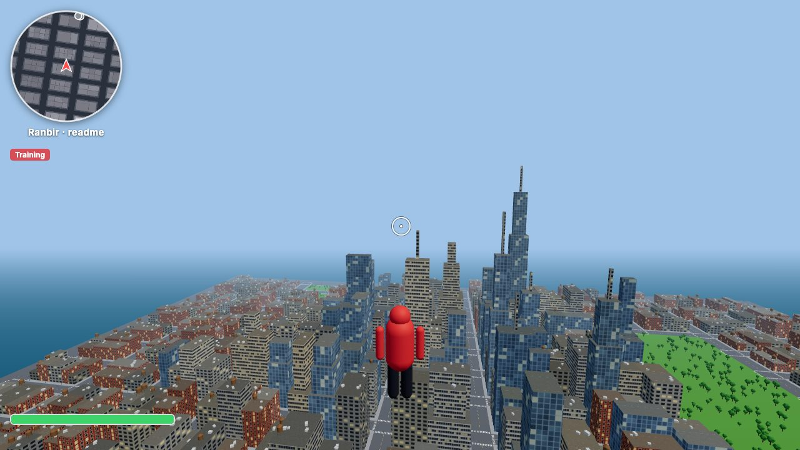

# The Swingfight Game

**Swing through a city. Fight your friends. Right in your browser.**

A fast, physics-driven web-swinging game with online multiplayer: swing between skyscrapers, run up walls, launch off rooftops, and battle your friends with web shots, yanks and zip strikes. No download and no account needed.

### ▶ [Play now: swingfight-game.onrender.com](https://swingfight-game.onrender.com)

> Hosted on a free server that naps when nobody's playing. If the page takes a minute to load the first time, it's waking up; after that it's instant for everyone.



---

## Features

- **Physics-based web swinging:** real momentum, a stretchy web, and release timing that matters. Chain swings to build speed, and let go at the right moment for a boost.
- **A whole city to explore:** about 1.2 km² of island downtown with skyscraper districts, a central park, rooftops, water towers and street lights, all generated in code so it loads in seconds.
- **Parkour:** wall running and climbing, zip-to-point, roof-edge launches, and bounces off walls.
- **Online multiplayer:** make a room, send your friends a link, and play together from anywhere.
- **Combat:** web shots, yanks, zip strikes, swing kicks, and a fatal yank-then-slam combo.
- **Game modes:** free-roam Brawl, solo Training against dummies, Tag, and Race (checkpoint rings through the city).
- **Day and night:** a 20-minute day shared by everyone online, with sunsets, stars and the city lighting up after dark.
- **An animated hero:** a jointed suited character that runs, swings, crawls up walls, zips, crouches and punches.
- **First or third person,** with camera shake, speed lines and G-force camera lag.
- **Rebindable controls,** saved in your browser.

<table>
  <tr>
    <td></td>
    <td></td>
  </tr>
  <tr>
    <td></td>
    <td></td>
  </tr>
</table>

## How to play

1. Open **[the game](https://swingfight-game.onrender.com)**, type a name and pick a mode.
2. **Playing with friends:** type a room name (or leave it blank) and press **Copy invite**. Send the link, and everyone who opens it joins your room.
3. Press **Enter**, then click to capture the mouse. **Esc** pauses and brings the menu back.

A mouse and keyboard on a desktop or laptop is recommended.

### Controls

These are the defaults. Change any of them under **Controls & key bindings** on the home screen.

| Key | Action |
|---|---|
| **W A S D** | Move |
| **Shift** | Sprint |
| **Space** | Jump · wall-jump |
| **Right click** (hold, in the air) | Web swing to the ◆ marker. Let go to fly |
| **Left click** (hold) | Web shots at the crosshair |
| **E** | Yank the player under the crosshair to the floor |
| **C** + **Right click** | Zip to the marker (on the ground or in the air) |
| **C** + **Left click** | Zip strike the player under the crosshair |
| **Tab** | Thwip: a quick horizontal boost (10 m+ up, every 2.5 s) |
| **V** | First / third person |
| **[** | Respawn |
| **G** | Race mode: start a race for everyone in the room |

### Tips

- **Swing timing:** let go on the upswing for a speed boost (the HUD shows *PERFECT / good / ok*). Hold past the top and you swing back like a pendulum.
- **Walls:** swing or run into a building and you stick to it. Push toward it to climb, and you vault onto the roof at the top.
- **Zips:** press **Space** during a zip to a roof edge to launch off it, or during a zip to a wall to bounce off it.
- **The combo:** a **yank** knocks someone down for 3 seconds, and a **zip strike** on a downed player is a one-hit **slam**.
- **Swing kicks:** just fly into someone fast. The faster you're going, the harder it hits.

### Game modes

| Mode | What happens |
|---|---|
| **Brawl** | The whole city, fighting on. 100 HP each, respawn 3 seconds after a knockout. |
| **Training** | Practice alone against dummies that stand, walk and fly. |
| **Tag** | No damage. If you're "it", hit someone to pass it on. Least time as "it" wins. |
| **Race** | Fly through the gold ring to start a time trial, or press **G** to start a countdown race for everyone. The server checks every ring, and the room keeps a leaderboard. |

Whoever opens a room picks its mode.

---

## Run it yourself

You need [Node.js](https://nodejs.org) 22+.

```bash
git clone https://github.com/SpaceOreo37/swingfight-game.git
cd swingfight-game
npm install
npm run dev     # game on http://localhost:5173 (+ game server on :3001), auto-reloads
npm test        # server + networking tests
```

Production-style, with one port for everything: `npm start`, then open http://localhost:3001.

### Hosting your own

Any host that runs a long-lived Node server with WebSockets works (Render, Railway, Fly.io, a VPS…).

- **Build command:** `npm ci --include=dev && npm run build`
- **Start command:** `npm run start -w server`
- **Health check:** `/health`

The server listens on `$PORT` and serves both the game and the multiplayer socket. Serverless platforms like Vercel won't work, because they can't keep WebSockets open.

## How it's built

- **TypeScript everywhere.** [Three.js](https://threejs.org) for rendering, [Vite](https://vitejs.dev) for the client, and a small Node + [ws](https://github.com/websockets/ws) server.
- **Lightweight by design.** The city, textures and props are all generated in code from a seed, so the whole game is under 200 KB compressed. Buildings are merged per area and repeated props are instanced, so the city draws in a few dozen calls.
- **Physics.** A fixed 60 Hz simulation with box collision against the city, a spring-based web, real air drag, and a few game-feel assists.
- **Multiplayer.**
  - **Movement:** each player simulates their own movement and sends it 20 times a second. The server sanity-checks it and broadcasts each room at 20 Hz.
  - **Smoothing:** other players are drawn slightly in the past and smoothly interpolated, so they don't jitter.
  - **Fair hits:** combat is decided on the server, which rewinds targets to what the attacker saw, so hits are fair even with lag.
  - **Web shots:** each shot's lifetime is fixed the moment it's fired, so nothing piles up on the server.
- **Protocol.** Every network message is defined and validated in one shared file (`shared/src/protocol.ts`), and is versioned so outdated clients get a clear "refresh" message.

```
shared/   Code used by both sides: city generator, collision, tuning, network protocol
server/   WebSocket game server: rooms, combat rules, training dummies, tests
client/   The browser game
  game/     Physics, cameras, rendering, avatar, input & key bindings
  combat/   Crosshair, web shots, hits, combat HUD
  net/      Connection, clock sync, smooth remote players
  ui/       Home screen, HUD, minimap, speed lines
```

Tuning lives in `shared/src/constants.ts` (movement, swinging, camera) and `shared/src/protocol.ts` (combat).

## Roadmap

- [x] City, swinging, wall running, zips and launches
- [x] Online multiplayer with rooms
- [x] Combat: Brawl, Training and Tag modes
- [x] Home screen and rebindable controls
- [x] Race mode, day/night cycle, animated hero
- [ ] Sound effects
- [ ] Cutting other players' web lines
- [ ] More race courses, and a downloadable character model

## Feedback

Found a bug or have an idea? [Open an issue](https://github.com/SpaceOreo37/swingfight-game/issues).

Made by **SpaceOreo37**.
